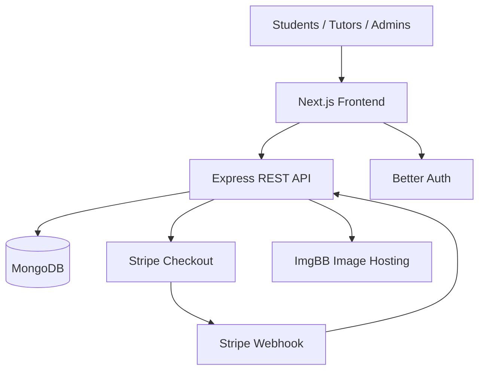

# MentorLagbe — System Architecture

## 1. Overview

MentorLagbe is a full-stack tuition management platform connecting students, tutors, and administrators.

The system uses a Next.js frontend, an Express REST API, MongoDB for persistent data, Better Auth for authentication, and Stripe Checkout for one-time membership payments.

## 2. High-Level Architecture

## 3. Frontend

The frontend is responsible for:

- User interface and navigation
- Role-based dashboards
- Authentication interfaces
- Tuition discovery and application workflows
- Tutor tuition management
- Admin management interfaces
- Membership pricing and checkout initiation
- Communicating with the backend API

Main technologies:

- Next.js
- React
- TypeScript
- Tailwind CSS
- HeroUI
- TanStack React Query
- Better Auth

## 4. Backend

The backend is an Express application responsible for:

- API routing and request handling
- Authentication integration
- Authorization and role checks
- Tuition and application business logic
- Dashboard statistics
- Admin moderation
- Payment session creation and webhook processing
- Image upload integration

## 5. Database

MongoDB is used as the primary database.

Main application collections:

- users
- tuitions
- applications
- payments

Better Auth also uses its required authentication collections.

Database indexes and collection validators are initialized during server startup.

## 6. Authentication and Authorization

Better Auth handles authentication.

Application roles:

- Student
- Tutor
- Admin

Protected backend operations enforce authentication and role-based access.

## 7. Payment Architecture

MentorLagbe uses one-time Stripe Checkout payments.

Configured membership prices:

- Student Pro: USD 10
- Tutor Pro: USD 15

The backend creates checkout sessions using server-defined pricing.

The Stripe webhook verifies incoming events before updating payment records and membership status.

The webhook flow still requires final end-to-end verification before production payment activation.

## 8. External Services

- MongoDB Atlas: Database hosting
- Stripe: Test-mode checkout and payment events
- ImgBB: Image hosting

## 9. Related Repositories

Frontend: https://github.com/arafat11223/mentorlagbe-client

Backend: https://github.com/arafat11223/mentorlagbe-server
